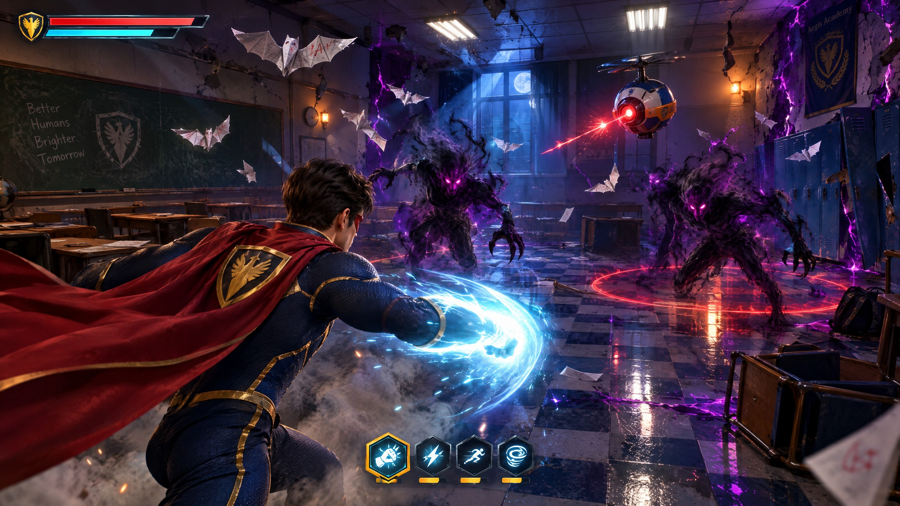
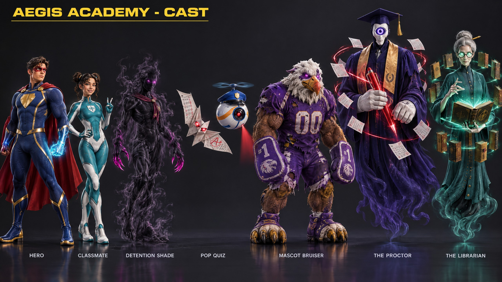
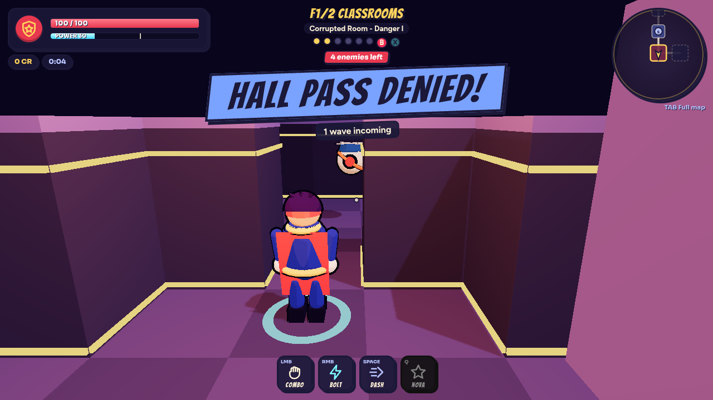

# Super Dungeon — Visual Overhaul Proposal

**Codename:** *Midnight Realism*
**Scope:** every 3D element on screen — player, classmates, enemies, bosses, environment, props, projectiles, particles, dust and VFX — plus the renderer that lights them.

---

## 1. Where we are today

| Area | Current state | Why it reads as "ugly" |
|---|---|---|
| Characters | Capsules, spheres and cones with a 3-step toon ramp and inverted-hull outlines | No anatomy, no faces, no cloth; the hero is a stack of primitives |
| Animation | Code-driven bobbing and limb swings on primitive groups | Stiff and weightless; no real punches, dodges or hit reactions |
| Environment | Untextured vertex-coloured boxes; flat pastel walls; one prop per wing made of boxes | No material identity (wood, vinyl, metal, plaster) and no sense of place |
| Lighting | Hemisphere + one directional + 3 point lights, toon-shaded | Flat, shadowless-looking, no bounce, no reflections |
| VFX | Flat additive quads, rings and cones | No softness, no volume, no light contribution; everything looks like paper |
| Post | Bloom only on High | No AO, no grading, no depth cues |

## 2. Art direction pillars

1. **Grounded materials, heroic accents.** Physically based materials everywhere: photoscanned vinyl, oak, plaster, brushed steel, paper, suit fabric. Strong saturated colour is reserved for powers, telegraphs, pickups and the Underhall corruption, so gameplay colour stays readable.
2. **Cinematic lighting.** Image-based lighting for real reflections, soft shadowed moonlight key, per-wing practical lights (flickering fluorescents, lab glow, trophy spots, library lamps), corruption rim light, AO and filmic grading.
3. **Real bodies, real motion.** Skinned PBR humanoids with a shared humanoid skeleton and motion-captured-quality animation clips (combo punches, dodge roll, casts, hit reactions, deaths), blended with crossfades.
4. **Living air.** Dust motes in light shafts, footstep and landing dust, embers leaking from corruption cracks, sparks, smoke and soft particles that interact with light.
5. **Readability first.** Telegraphs stay bright and unmistakable; enemies keep distinct silhouettes; the hero always has a rim light; nothing realistic is allowed to hide a gameplay signal.
6. **Performance is a feature.** 60 fps on a mid-range laptop at Medium quality, with staged streaming preserved (title + first wave first, the rest in the background, paused while combat is hot).

> Why "Midnight Realism" and not pure photorealism: a browser game has to stream in seconds and hold 60 fps. We push realism where the eye lands (characters, materials, light, VFX) and use stylised-realistic character bases (semi-realistic anatomy with PBR skin and fabric), which keeps the superhero comic energy while looking dramatically more real.

## 3. Rendering pipeline

| Feature | Low | Medium | High |
|---|---|---|---|
| PBR `MeshStandardMaterial` / `MeshPhysicalMaterial` with normal + roughness maps | yes | yes | yes |
| Image-based lighting (PMREM room environment, tinted per wing) | yes | yes | yes |
| Soft shadows (PCF soft, player-following key light) | off | 1024 | 2048 |
| Ambient occlusion (GTAO) | off | off | yes |
| Bloom (energy, emissive corruption, pickups) | off | yes | yes |
| Colour grade + vignette + subtle grain, hit-flash chromatic pulse | grade only | yes | yes |
| Anti-aliasing | FXAA-free (pixel ratio 1) | MSAA | MSAA + pixel ratio 2 |
| Particle budget | 50% | 100% | 100% |

- **Tone mapping:** AgX/ACES filmic with per-wing exposure.
- **Fog:** exponential height-style fog tinted per wing, giving depth to the Underhall.
- **Light shafts:** additive volumetric cones with animated dust, cheaper than raymarched volumetrics.
- **Contact shadows:** soft blob decals under characters so they sit on the floor even on Low.

## 4. Characters

**Base:** Quaternius *Universal Base Characters* — `Superhero_Male_FullBody` and `Superhero_Female_FullBody` (CC0). They have semi-realistic anatomy, PBR skin (base colour, normal, roughness), a standard humanoid skeleton, eyes, and hair and eyebrows rigged to the head bone.
**Motion:** Quaternius *Universal Animation Library* (CC0), which has the same skeleton, so every clip plays on every humanoid.

### 4.1 Hero — "Super" student hero
- **Suit:** an offline *suit painter* script paints a skin-tight navy technical-fabric super suit into the body's base-colour texture by skeleton region: gold piping at the seams, a gold belt, crimson boots and gloves, and a gold shield emblem on the chest. The anatomy normal map is kept, so the suit reads like a real muscle-sculpted hero suit.
- **Mask:** a red domino mask painted into the face region.
- **Hair:** *SimpleParted* hairstyle with PBR hair cards, plus eyebrows.
- **Cape:** a separate crimson cloth mesh on the upper-spine bone, simulated with a small spring-chain (verlet) system so it trails, flutters when dashing and settles when idle. This fixes the cape direction for good.
- **Animation map:** idle, jog, sprint, 3-hit combo (jab, cross, hook/kick), dodge roll (dash), one-hand cast (bolt), two-hand ground slam (nova), hit react, death, victory. All transitions use crossfades, and root motion is ignored (gameplay drives movement).
- **Readability:** cool rim light and a subtle ground ring.

### 4.2 Classmates (rescue targets) and hub statues
- Classmates use the female and male bodies with alternate suits (teal/white, crimson/black, green/gold) and hairstyles (Buns, Long, Buzzed). They idle while waiting and wave or cheer when rescued.
- Hub statues are the hero mesh frozen in heroic animation poses, with a bronze/marble PBR material. They are real sculptures, not stacked cylinders.

## 5. Enemies

| Enemy | New design | Source | Motion |
|---|---|---|---|
| **Detention Shade** | Humanoid of living smoke: the base body drawn with a custom shadow shader (dark translucent core, animated noise erosion, fresnel magenta rim, glowing eyes, smoke wisps peeling off) | Universal Base Characters + custom shader | UAL walk, zombie lunge, slash, hit, death (dissolve) |
| **Pop Quiz** | Origami bat folded from an exam sheet with red ink grades, glowing red eyes | Tripo3D generated PBR mesh | Vertex-shader wing flap, banking flight |
| **Hall Monitor** | Floating security drone: glossy ceramic-white and blue shell, orange sash stripe, peaked cap top, rotor, red camera eye with a visible spotlight cone | Tripo3D mesh + procedural rotor, lens glow and cone | Hover bob, lean into movement, recoil on fire |
| **Mascot Bruiser** | Hulking corrupted sports mascot: oversized body in a torn purple "00" jersey, plush griffin mascot head with violet eyes | Base male body scaled ×1.55 with a painted jersey + Tripo3D mascot head on the head bone | UAL heavy walk, overhead slam, roar, hit, death |
| **Elite variants** | Gold emissive halo, brighter rim, corruption embers | Shader + particles | — |

## 6. Bosses

| Boss | New design | Source |
|---|---|---|
| **The Proctor** | A towering floating spectral exam proctor: deep-indigo academic gown, gold stole, mortarboard with tassel, porcelain mask with one huge glowing eye, giant pale gloved hands (one grips a glowing red pen), exam pages orbiting | Tripo3D gown/body + separate Tripo3D gloved hands and pen, with the eye, pages and hem glow driven procedurally |
| **The Librarian** | A towering spectral librarian: long teal cardigan robe with brass buttons, grey bun with a pencil, glowing mint round spectacles, long ghostly hands, a floating open tome and a ring of old leather books | Tripo3D body + ghostly hands + open tome + leather book (instanced ring) |

The bosses float, so rigid meshes animate convincingly: bob, sway, lean into attacks, a vertex-shader hem ripple, hand choreography (slams, sweeps, casts), eye and lens flare on wind-ups, and dissolve on defeat. Both keep their current hit boxes and attack timings.

## 7. Environment

### 7.1 Surfaces (Poly Haven, CC0, photoscanned PBR)
| Wing | Floor | Walls | Trim |
|---|---|---|---|
| Hub — Hall of Origins | Polished marble / granite tile | Painted plaster | Dark oak wainscot |
| Corrupted Classrooms | Checkered vinyl floor tiles | Painted plaster | Oak wainscot, chalkboards |
| Unstable Labs | Anti-skid / concrete tiles | White tiled walls | Brushed steel |
| Trophy Hall | Herringbone parquet / walnut | Red weathered plaster | Brass rail |
| Haunted Library / Stacks | Worn wood planks | Plaster-stone | Walnut veneer |
| Anti-Gravity Gym | Sports-court wood | Painted block wall | Coloured stripe paint |

Tiling is world-space (tri-planar-style UVs baked at build time), so rooms of any size tile correctly. Corruption veins are an emissive magenta crack decal layer, which varies by seed.

### 7.2 Props (instanced, PBR)
- **Classrooms:** Poly Haven *School Desk 01*, Tripo3D metal locker bank, chalkboard, scattered exam papers.
- **Labs:** Tripo3D lab bench with glassware (emissive liquids), steel frame shelves.
- **Trophy Hall:** Tripo3D glass trophy case with gold cups.
- **Library / Stacks:** Tripo3D tall bookshelf filled with books, reading lamp.
- **Gym:** Tripo3D stacked gym mats / vaulting box.
- **Hub:** hero statues (hero mesh, bronze), fountain, vending machine, portal.

Every prop is merged into a single draw call per prop type with `InstancedMesh`, and gets a soft contact shadow.

### 7.3 Lighting per wing
Flickering fluorescent panels (classrooms), green chemical glow (labs), warm gallery spots (trophy), low amber reading lamps + cold moonlight (library), coloured stadium floods (gym). The corruption adds a magenta rim everywhere. Light shafts with dust motes sit at windows and doors.

## 8. VFX, particles, dust and projectiles

A new **GPU-instanced soft-particle system** (one draw call per blend mode) uses textures from Kenney *Particle Pack* and *Smoke Particles* (CC0): smoke puffs, soft glows, sparks, flares, magic swirls, scorch and dirt.

| Effect | New look |
|---|---|
| Footsteps / landing / dash | Low dust puffs that swell, drift and fade; dash leaves a ribbon of dust and an afterimage ghost of the hero |
| Punch | Curved energy swoosh (ribbon trail following the fist bone), impact flash sprite, radial sparks, micro camera shake, 40 ms hit-stop |
| Critical hit | Larger flare, gold sparks, brief chromatic pulse |
| Power Bolt | Hot white core + cyan glow sprite, ribbon trail, crackling sparks, travelling point light, impact burst with smoke |
| Nova | Expanding shockwave ring with a heat-distortion look, ground scorch decal, rising dust and debris |
| Enemy projectiles | Red ink orbs with smoky trails (Monitor), paper shreds (Pop Quiz), glowing exam pages (Proctor), spectral pages (Librarian) |
| Telegraphs | Ground decals with an animated fill-up edge and soft glow; lines and cones for beams and sweeps |
| Deaths | Noise-dissolve with glowing edges + ember burst + smoke (Shades turn to smoke) |
| Pickups | Holographic fresnel orbs with inner swirl, orbiting motes and a light pool |
| Hazards | Acid pools with bubbles and steam, Tesla sparks with arcs, lasers with glow and a heat haze strip, falling tomes with dust |
| Ambient | Dust motes in light, embers rising from corruption, occasional floating papers |

All particle emitters respect the existing **heat gauge**. When combat is hot, background streaming pauses, and ambient emitters thin out before combat effects ever do.

## 9. Performance and streaming budget

| Budget | Target |
|---|---|
| Frame time (Medium, mid laptop) | 16.6 ms |
| Draw calls in a combat room | ≤ 250 |
| Triangles on screen | ≤ 600 k |
| Skinned characters on screen | ≤ 16 |
| Initial download before the title screen | ≤ ~3 MB (hero + first-wing textures) |
| Texture format | WebP (1024 characters, 512–1024 surfaces), mipmapped |
| Mesh format | GLB with meshopt compression and quantisation |

Assets join the existing staged streamer. The **title stage** gets the hero and hub materials. **Wave 1** gets the floor-1 wing materials, props and first enemies. **Background stages** get the other enemies, then bosses, floor 2 and the classmates. The heat gate still pauses background loading during heavy combat.

## 10. Asset sources and licences

| Asset | Source | Licence |
|---|---|---|
| Hero, classmates, Shade and Bruiser bodies, hair | Quaternius — Universal Base Characters | CC0 1.0 |
| All humanoid animation clips | Quaternius — Universal Animation Library | CC0 1.0 |
| Floor, wall and trim materials; school desk | Poly Haven | CC0 1.0 |
| Particle and smoke sprites | Kenney — Particle Pack, Smoke Particles | CC0 1.0 |
| Drone, origami bat, mascot head, bosses, lockers, shelves, trophy case, lab bench, gym mats, books | Tripo3D (generated for this project) | Generated asset |
| Concept art | GPT Image 2.5 (generated) | Generated asset |

## 11. Risks and mitigations

| Risk | Mitigation |
|---|---|
| Base bodies wear underwear only | The offline suit painter recolours every body region into a full suit before shipping |
| Generated meshes arrive at the wrong scale or facing | Normalisation step (height, pivot to feet, facing −Z) + a `?viewer` model-viewer page to verify every model |
| Download size growth | WebP + meshopt, 1024 caps, shared textures, staged streaming, only needed animation clips |
| Realism hurting readability | Telegraph and pickup colours unchanged, hero rim light, elite halos, and a readability pass in QA |
| GPU cost of skinned meshes | Shared skeleton clips, frustum culling, shadow casting only for close characters, Low preset without shadows or AO |

---

# Implementation plan

| Phase | Work | Acceptance |
|---|---|---|
| **P1 Asset pipeline** | Retrieve UBC, UAL, Poly Haven and Kenney assets; build `scripts/assets/` tools: suit painter, GLB builder (merge body + hair + selected clips, WebP textures, meshopt), Tripo3D batch generator, normaliser | Reproducible `public/models/*.glb` and `public/tex/*` with a size report |
| **P2 Renderer** | PBR switch, PMREM IBL, AgX/ACES, per-wing fog/exposure, GTAO (High), grade + vignette + grain, quality presets | Title and hub render with realistic light; presets switch live |
| **P3 Characters** | GLTF loading via streamer, `AnimatedCharacter` (mixer, crossfades, clip map, bone sockets), hero with cape sim, classmates, statues | Hero plays every state correctly; cape trails behind |
| **P4 Enemies & bosses** | Shade smoke shader, Bruiser + mascot head, Monitor and Pop Quiz meshes, Proctor and Librarian rebuilt on generated meshes; dissolve deaths; hit flash via emissive | Every enemy readable, animated and hit-flashing; bosses keep all attacks |
| **P5 Environment** | PBR wing materials with world UVs, instanced PBR props, wall trims, corruption decals, practical lights, light shafts | Each wing is recognisable at a glance |
| **P6 VFX** | Soft-particle system + atlases, punch ribbons, bolt/nova/telegraph/death/pickup/hazard rewrites, dust, embers, hit-stop | All effects soft, lit and within budget |
| **P7 Tools & QA** | `?viewer` model viewer (rotation, clips, stats), smoke test, boot/perf profile, unit tests, build size budget | Smoke passes; fps and size targets met; screenshots reviewed |
| **P8 Ship** | README/notes, checkpoint push | Checkpoint recorded on `main` |
